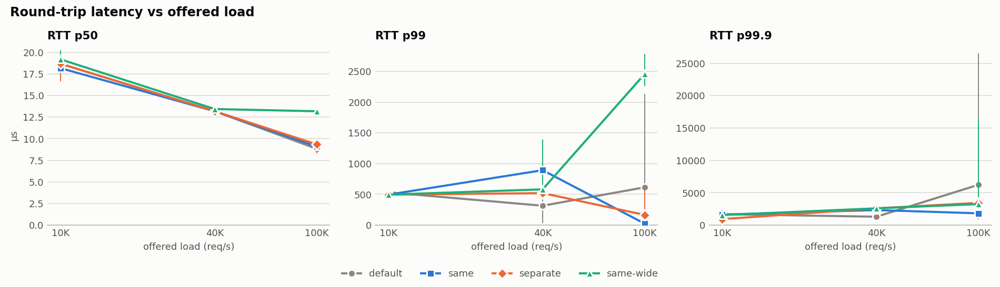
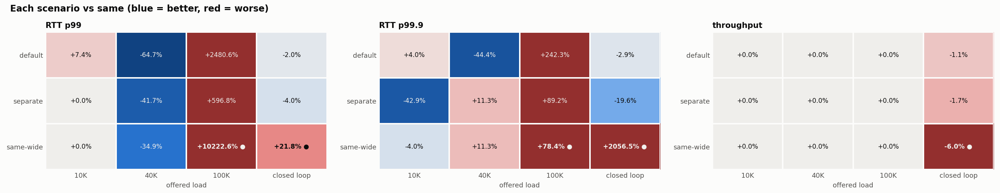
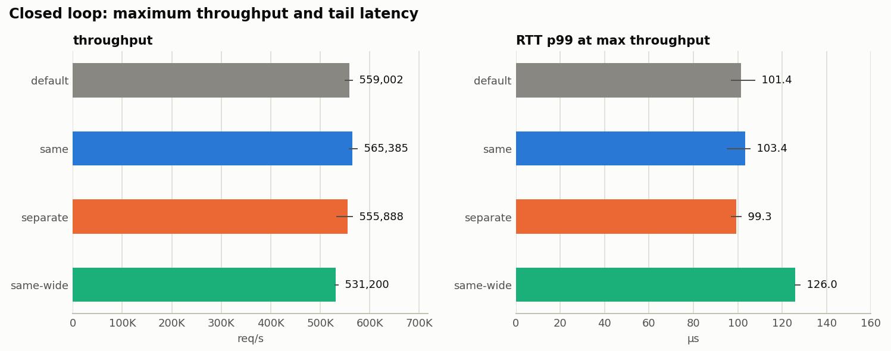
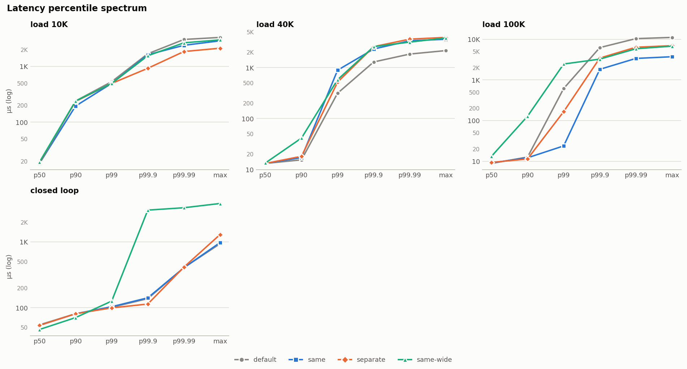
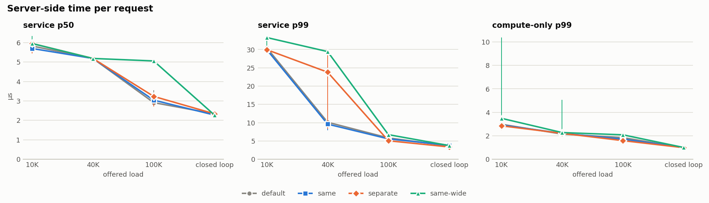
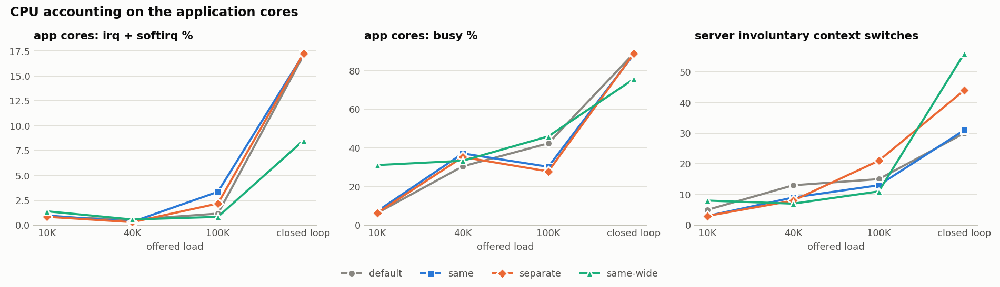
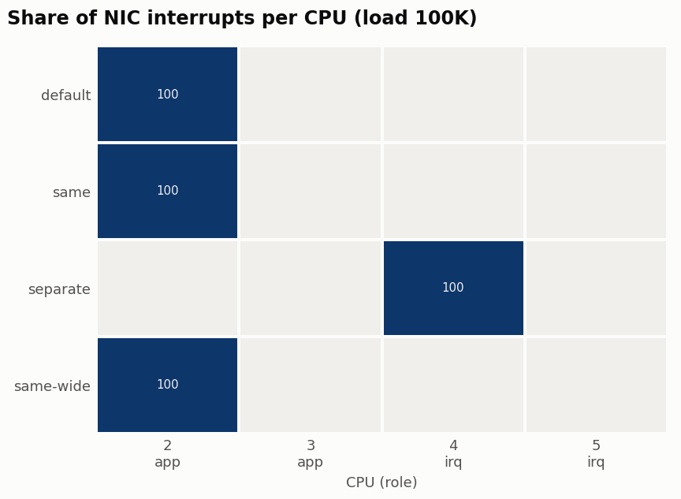

# Examples

- **Running real benchmarks:** [`REAL-BENCHMARKS.md`](REAL-BENCHMARKS.md) is a step-by-step runbook for
  AWS metal instances and a market-data app on isolated cores (topology, setup, a rehearsal, four kinds
  of real run, sizing, and reading the results). [`run-real-benchmark.sh`](run-real-benchmark.sh) wraps
  it: fill in its config block and run `check`, `rehearsal`, `pcap`, `cmd`, `ptp`, `samewide` or `rpc`.
  `DRY_RUN=1` prints a phase's plan first.
- **Sample reports:** below.

# Sample reports

There are two complete results directories:

| sample | workload |
|---|---|
| [`sample-loopback/`](sample-loopback/) | synthetic request/response (`--workload rpc`, the default) |
| [`sample-app-loopback/`](sample-app-loopback/) | application mode (`--workload app`): the synthetic feed handler `rpcbench sub` restarted on CPUs 2-3 in every scenario, a built-in burst publisher at 100K and 400K msg/s, and one-way latency, drops, sequence gaps and app-core interference |

The rest of this page describes `sample-loopback/`. The app sample has the
same structure, plus its own charts (`interference`, `app-threads`, and
`drops` when there are any) and `app.log`.

Both samples were recorded on a development box rather than on AWS, so their
`meta.json` and summaries show that box's NIC. On an AWS host, the equivalent
command uses your ENA interface:

```bash
sudo ./irqbench.py run --workload app --iface ens5 --app-cpus 2-3 --irq-cpus 4-5 --peer local \
     --app-cmd '{bin} sub --port {port} --threads {ncpus} --cpus {cpus} --spin --stats-file {stats}' \
     --app-ready udp:9100 --feed builtin --feed-dest 127.0.0.1 --feed-burst 20 --latency builtin \
     --rates 100000,400000 --reps 3 --duration 3 --warmup 0.5 --settle 0.5 --calibrate 1 \
     --out examples/sample-app-loopback
./irqreport.py examples/sample-app-loopback --link-images
```

## `sample-loopback/`

[`sample-loopback/`](sample-loopback/) is a complete results directory from a
real `irqbench.py` run. It shows what the benchmark produces: the HTML report,
the PNG charts (light and dark), the Markdown/CSV summaries, and the raw
per-run JSON.

> **Format demos only. Neither sample's numbers say anything about IRQ placement.**
> Both runs used `--peer local`, so the load generator was on the same host and
> traffic went over loopback, which never raises NIC interrupts. The report
> says this at the top. For real results, run against a separate load
> generator, for example a second AWS metal instance in the same cluster
> placement group. See the main [README](../README.md).

## How it was produced

The equivalent command on an AWS host (only `--iface` differs from the
development box the sample came from):

```bash
sudo ./irqbench.py run --iface ens5 --app-cpus 2-3 --irq-cpus 4-5 \
     --peer local --client-cpus 0,1 --reps 3 --rates 10000,40000,100000,0 \
     --duration 3 --warmup 0.5 --settle 0.5 --out examples/sample-loopback
./irqreport.py examples/sample-loopback --link-images
```

- **Host:** a development box (Intel Core Ultra 9 285H, kernel 6.17, Realtek r8169 NIC), not an AWS instance.
- **Run:** UDP, blocking server, 3 reps × 3 s for each of 4 scenarios × 4
  loads, giving 48 runs.
- **Redactions:** the hostname and kernel command line in `meta.json` were
  replaced before the report was regenerated. Nothing else was changed.
- **Images:** `--link-images` makes `report.html` reference `charts/*.png`
  instead of embedding them, so it needs the `charts/` folder next to it.
  Without the flag you get a single self-contained file.

## Files

| file | contents |
|---|---|
| [`report.html`](sample-loopback/report.html) | the full report; download it, or clone the repo and open it locally |
| [`summary.md`](sample-loopback/summary.md) | the same summary as Markdown |
| [`summary.csv`](sample-loopback/summary.csv) | one row per mode × load × scenario (median, min, max) |
| [`runs.jsonl`](sample-loopback/runs.jsonl) | raw client, server and per-CPU accounting for every run |
| [`meta.json`](sample-loopback/meta.json) | host, NIC and arguments, plus the IRQ/RPS state before the run |

## Charts

### Latency vs offered load


### Change vs `same`


### Closed-loop throughput


### Percentile spectrum


### Server service time


### CPU accounting on the app cores


### Where NIC interrupts landed


Every chart also has a `-dark.png` version for dark backgrounds.
